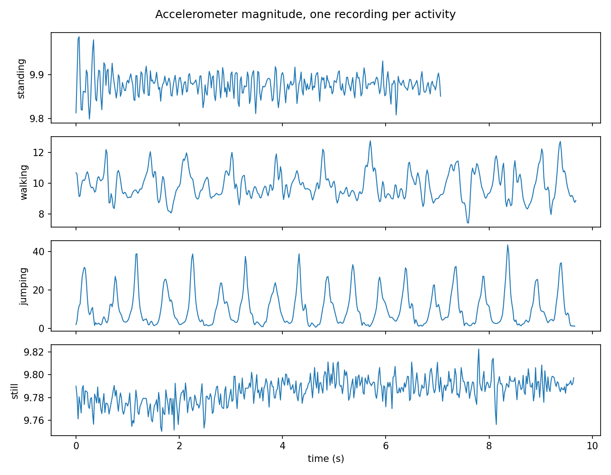
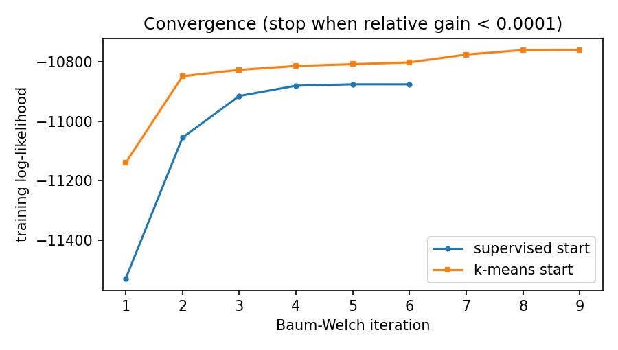
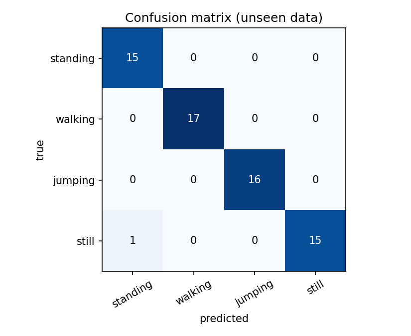
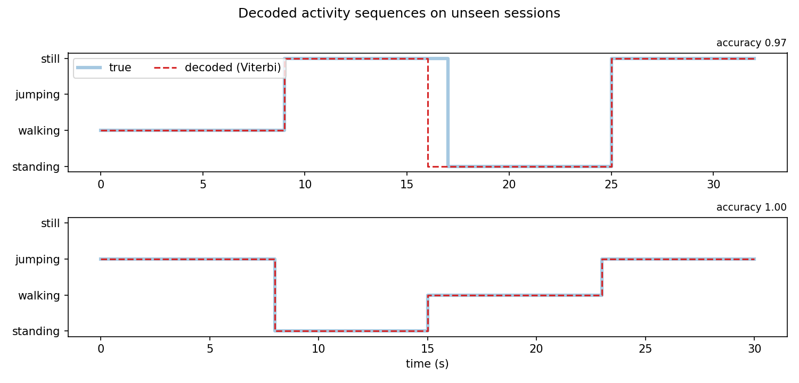
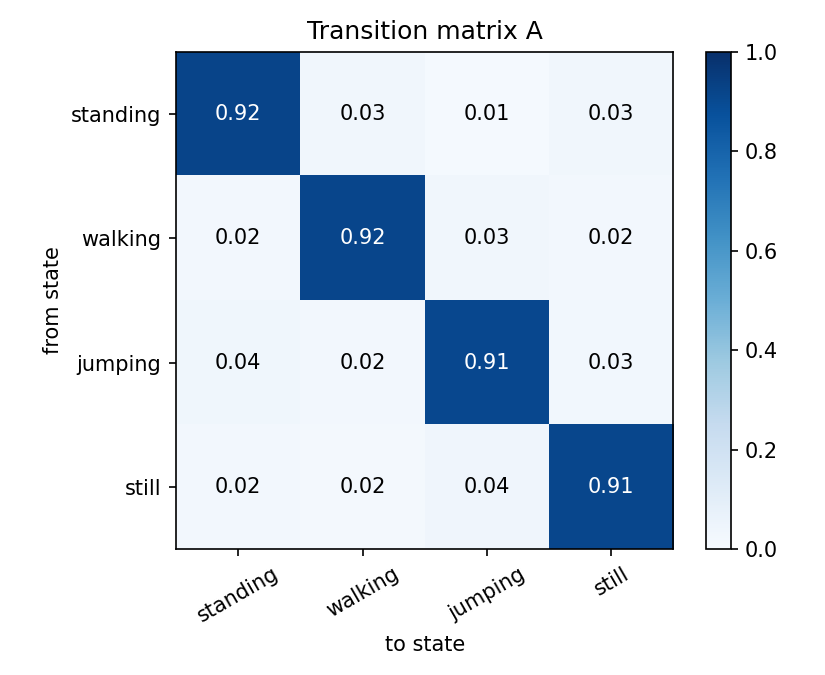
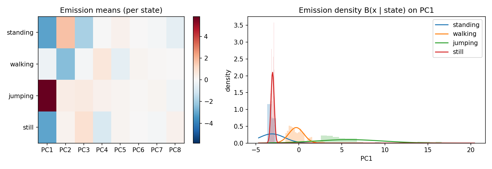

# Modeling Human Activity States Using Hidden Markov Models

**Author:** kalisa10 (individual project) · **Repository:** github.com/kalisa10/Formative-2---Hidden-Markov-Models · **Notebook:** `notebooks/hmm_activity_recognition.ipynb`

## 1. Background and Motivation

Smartphones carry an accelerometer and a gyroscope that record how their owner moves, but the activity itself (standing, walking, jumping, resting) is never observed directly. It is hidden behind noisy measurements. My use case is a personal activity tracker running on a phone. It would separate time spent active from time spent sedentary, so that a long uninterrupted still period can trigger a reminder to move. Such a tracker needs a model that decides which activity is happening from a stream of sensor readings, and that exploits the fact that activities last for a while before changing. A Hidden Markov Model (HMM) does this: the hidden states are the four activities, the observations are features computed from short sensor windows, and the transition matrix encodes that people tend to keep doing what they are doing. I recorded my own data, built the HMM from scratch with NumPy, and tested it on recordings it had never seen.

## 2. Data Collection and Pre-processing

**Recording.** I used the Sensor Logger app on a Google Pixel 3a (Android), logging the accelerometer and gyroscope (x, y, z each) at a requested 50 Hz, with the phone held at waist level. Four activities were recorded: **standing**, **walking**, **jumping** and **still** (phone flat on a surface). Each clip is about 10-12 s long. Training data is 10 clips per activity (40 clips, about 118 s of raw recording per activity), recorded in two sessions: 20 clips on 26 Oct 2026 in five different places (a baseline spot, outdoors, on the stairs, in the bathroom and in a room) and 20 clips on 29 Oct 2026, with the phone held in different positions. Using several places, days and phone positions stops the model from learning one location or one grip. With the 8 unseen clips (about 24 s per activity), the total is about 142 s per activity. Every file is named `kalisa10_<activity>_<nn>`, and the processed CSV files in `data/processed/` hold a `timestamp` column plus the six sensor channels.

**Video evidence.** One video per activity, each showing my whole body and face while I hold the phone and Sensor Logger records:

| Activity | Video |
|---|---|
| Standing | https://drive.google.com/file/d/1IsrgzqzaveB-ls6wlCweYWEGJ0Nyu8lj/view?usp=sharing |
| Walking | https://drive.google.com/file/d/1ZM3M0xJ0T_1srJwOV-AU4O60Caq5uFqG/view?usp=sharing |
| Jumping | https://drive.google.com/file/d/16drKydAr9-TuD7tQV7_84wIcj8jVovsL/view?usp=sharing |
| Still | https://drive.google.com/file/d/1eaPmUTchmALTQtLwEn2yG-X0EFtxfR40/view?usp=sharing |

**Sampling rate and harmonisation.** There is a single member and a single phone, so there is one native rate. The table gives the rate measured from the median spacing of the timestamps.

| Member | Device | Requested rate | Measured native rate | Harmonised rate |
|---|---|---|---|---|
| kalisa10 | Pixel 3a | 50 Hz | 50.7 Hz | 50 Hz |

The accelerometer and gyroscope are logged with slightly different timestamps, and the real rate (50.7 Hz) is not exactly the requested one. Every recording is therefore linearly interpolated onto one common 50 Hz time grid for all six channels. This also makes the pipeline ready for phones with other rates. The first and last second of each clip are trimmed to remove the taps used to start and stop recording. For three clips where the phone was still being moved at the start or end, a longer trim was applied (see `TRIM_OVERRIDE` in the notebook).

**Windowing.** The signal is cut into 2 s windows (100 samples at 50 Hz) with 50 % overlap. The size follows from the sampling rate. The FFT resolution is 1/2 s = 0.5 Hz, which is enough to place a walking cadence of about 1.5-2 Hz. A 2 s window contains at least three steps or jumps, so every window sees whole movement cycles. The Nyquist limit of 25 Hz is far above the 0.3-15 Hz band where human motion lies. The overlap doubles the number of windows from the short clips. This gives 328 training windows and 64 unseen windows.

**Features.** From each window I compute 38 features: per channel the mean, variance and standard deviation (time domain); the signal magnitude area (SMA) and the correlations between axes, for both sensors (time domain); and, from the FFT of the accelerometer and gyroscope magnitudes, the dominant frequency, the total spectral energy and the energy in four bands, 0.3-1, 1-3, 3-6 and 6-15 Hz (frequency domain). The mean carries gravity, so it separates a phone lying flat from one held upright. Variance, standard deviation and SMA measure movement intensity. Axis correlation describes how the motion is coordinated. Dominant frequency and band energies describe its rhythm. The data bear this out: the mean spectral energy of the accelerometer is 0.005 for still, 1.9 for standing, 159 for walking and 5584 for jumping.

**Normalisation.** Features are standardised with a Z-score (training mean and standard deviation, re-used unchanged on the unseen data). They have different units and differ by orders of magnitude, so without scaling the spectral energy would dominate the PCA and the Gaussians. Z-scores need no fixed range, whereas min-max scaling would be distorted by a single jump impact. PCA then reduces the 38 features to 8 components (82.9 % of the variance), which removes the correlation between features and lets one full-covariance Gaussian per state be estimated from few windows.

## 3. HMM Setup and Implementation

**Components.** The hidden states Z are {standing, walking, jumping, still}. The observations X are the 8-dimensional PCA vectors, one per window. The initial probabilities π give the chance that a sequence starts in each activity. The transition matrix A gives P(next activity | current activity). The emission probabilities B are one multivariate Gaussian per activity. The model is written from scratch in NumPy (class `GaussianHMM`), with all recursions in log space for numerical stability.

**Algorithms.** Three algorithms fit the task, and each ties to a metric:

* **Supervised estimation** counts the transitions and computes the Gaussian moments from the labelled windows. It gives the starting parameters.
* **Baum-Welch (EM)** re-estimates π, A, μ and Σ from the observations using the forward-backward algorithm. It stops when the relative improvement of the training log-likelihood falls below ε = 10⁻⁴ (or after 200 iterations). Started from the supervised estimate it converged after 6 iterations (log-likelihood -10876.4). Started from a label-free k-means clustering it converged after 9 iterations to a slightly higher log-likelihood, -10760.8 (Figure 2). After mapping its states to activities with a Hungarian assignment, the label-free model recognises the unseen clips as well as the supervised one, so Baum-Welch does recover the activity structure from the signals alone.
* **Viterbi** returns the single most likely activity sequence, which is what the confusion matrix, sensitivity, specificity and accuracy are computed from. Forward-backward posteriors are used for confidence.

Because the labels are known, the 40 training sequences were built by stitching 5 randomly chosen training clips each, so that the sequences contain activity changes and A can be estimated.

## 4. Results and Interpretation

**Unseen data.** The model was tested on 8 new clips (2 per activity, about 12 s each) that were never used for training, scaling or PCA. They were recorded on 26 Oct 2026, about 20 minutes after the last clip of the first training session, by the same person with the same phone, and none of them was used for training, scaling or PCA. They were stitched into **2 test sequences** (30 s and 32 s) containing real activity changes. The unseen data is therefore new recordings from the same person and phone, not a new person or phone. It tests generalisation to new clips, not to new users.

| State (Activity) | Number of Samples (windows) | Sensitivity | Specificity | Overall Accuracy |
|---|---|---|---|---|
| Standing | 15 | 1.000 | 1.000 | 1.000 |
| Walking | 17 | 1.000 | 1.000 | 1.000 |
| Jumping | 16 | 1.000 | 1.000 | 1.000 |
| Still | 16 | 1.000 | 1.000 | 1.000 |
| **All** | **64** | | | **1.000** |

Sensitivity, specificity and accuracy are computed one-versus-rest from the confusion matrix. The Viterbi-decoded sequences have an overall accuracy of 100 % (64 of 64 windows). A frame-by-frame Gaussian classifier with no transition matrix reaches 98.4 % (one window wrong), so the HMM's transition structure removes that last error.

**Transition and emission probabilities.**

## 5. Discussion and Conclusion

**Easiest and hardest activities.** All four activities were recognised on the unseen data, so the test set cannot rank them directly. The evidence from the features and the model does. Walking and jumping are the easiest: their energy is orders of magnitude higher than the static classes, and jumping is further set apart by its impact spikes. The first emission component separates the two moving classes, and both from the static ones (Figure 6, right). Their dominant frequencies, 1.88 Hz for walking and 2.04 Hz for jumping, are almost the same, so it is the energy, not the cadence, that tells them apart. The hardest pair is **still versus standing**. Both are nearly motionless, and their emission densities overlap on the first component (Figure 6, right). The standing density is also wide, because the standing clips differ in phone orientation and body sway. What separates the two is mainly the orientation of the phone (gravity in the mean features) and the small sway of a standing body. This is also where the earlier version of the model, trained on only the first 20 clips, made its single error (a still window decoded as standing), and it is the pair that would fail first with a new phone position.

**Transition probabilities.** The diagonal of A is 0.92-0.94 for every activity, so the model expects an activity to persist for roughly twelve windows. That matches the real behaviour of holding one activity for several seconds, and it is what lets Viterbi smooth over single doubtful windows. The off-diagonal values (0.01-0.04) are almost uniform, and this should not be read as human behaviour. My sequences were stitched together from separate clips in random order, so these values reflect how I assembled the data, not how often people go from walking to standing. Real transitions would need long continuous sessions with natural changes of activity.

**Effect of noise and sampling rate.** The phone delivers 50.7 Hz instead of the requested 50 Hz, with slightly different timestamps for the two sensors. Resampling to a common grid removed this mismatch, and 50 Hz is high enough for the 0.3-15 Hz motion band. Sensor noise matters mostly for the static classes. For standing and still, the dominant frequency is simply a noise peak (8.1 Hz and 5.2 Hz on average) and carries no information, which is one reason I rely on the energy, variance and orientation features. Taps at the start and end of a clip also corrupted a few recordings, so trimming was necessary.

**Limitations and improvements.** The result of 100 % is based on only 64 windows (8 clips) from one person and one phone, so it is optimistic: a perfect score on a small test set does not mean the model is perfect, and one wrong window would change the accuracy by 1.6 percentage points. The model has not been shown to work on other people or other phones. Improvements would be: more data per activity, recorded on different days and with the phone in different positions (pocket, hand, bag); more participants and phones, with the sampling-rate harmonisation tested on other rates; continuous recordings with real transitions to estimate A; richer features (for example wavelet or autocorrelation features); additional sensors such as a magnetometer or barometer; and a mixture of Gaussians per state to capture variation within an activity.

**Conclusion.** An HMM built from scratch, with Baum-Welch training and Viterbi decoding on time- and frequency-domain features, recognised four activities from phone motion data with 100 % accuracy on unseen recordings (98.4 % without the transition matrix). The likely weak point is separating still from standing, and the honest next step is to test the model on other people and phones.
